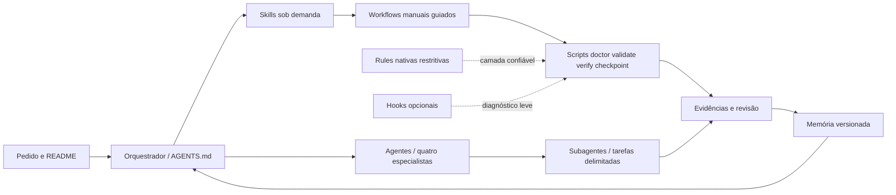

# Harness de desenvolvimento com IA

Base local de ferramentas introduzida em 28/10/2026 após a estabilização do
esqueleto, antes da implementação funcional. O [README](../README.md) continua
definindo o produto. Nenhuma decisão de banco/auth foi antecipada.

Comece na raiz com `node scripts/harness/harness.mjs doctor` e `validate`.
Use `verify` para as verificações desta etapa. Para retomar: leia
[handoff](harness/memory/handoff.md), compare Git e execute a skill
`resume-project` descoberta localmente, ou leia seu SKILL.md explicitamente
se a superfície não apresentar o seletor. [Comandos completos](harness/commands.md).

Os oito componentes e seus estados estão na [matriz](harness/capabilities.md).

- **Rules:** orientações de engenharia em AGENTS.md e regras nativas de execução
  em `.codex/rules/`. As primeiras guiam o trabalho; as regras restritivas verificam
  prefixos de comandos e não constituem uma barreira universal.
- **Skills:** procedimentos reutilizáveis em `.agents/skills/`, carregados sob
  demanda para planejar, entregar, revisar, verificar, registrar e retomar.
- **Agentes:** papéis com responsabilidades definidas. O orquestrador coordena;
  os quatro especialistas são Documentação, Frontend, Backend e Banco de Dados.
  Suas definições ficam em `.codex/agents/`.
- **Subagentes:** instâncias que recebem tarefas delimitadas pelo orquestrador,
  com fontes, arquivos atribuídos, critérios de aceite e limites de execução.
  Um papel pode ser usado por diferentes instâncias ou em tarefas sequenciais.
- **Comandos:** scripts executáveis em `scripts/harness/`; doctor diagnostica,
  validate confere artefatos, verify agrega verificações e checkpoint propõe
  um registro do estado sem gravar a memória automaticamente.
- **Workflows:** procedimentos manuais guiados por skills que conectam tarefas,
  comandos, revisão e evidências. São distintos do CI do GitHub Actions.
- **Hooks:** automações opcionais do ciclo do Codex, configuradas em
  `.codex/hooks.json`, que exigem revisão de confiança antes da execução.
  Os handlers de diagnóstico são orientativos; seu disparo real não foi demonstrado.
- **Memória:** resumos explícitos e versionados em `docs/harness/memory/`, com
  estado, decisões, lições e handoff. A retomada exige leitura e reconciliação com
  Git e fontes canônicas; essa pasta não é carregada automaticamente.

O orquestrador coordena escopo, contratos, integração, divergências e conclusão;
Documentação consolida, Frontend cuida UI/cliente/clima, Backend cuida API/auth,
Banco cuida integridade/migrations. Segurança/qualidade são transversais. Consulte
[contrato de delegação](harness/delegation.md) e [política de contexto](harness/TOKEN_POLICY.md).

Workflows, todos manuais guiados por skills, com comandos executáveis:

- [bootstrap](harness/workflows/bootstrap.md): diagnóstico e contexto selecionado.
- [delivery](harness/workflows/delivery.md): requisito até evidência consolidada.
- [security-review](harness/workflows/security-review.md): análise, correção atribuída e verificação.
- [handoff-resume](harness/workflows/handoff-resume.md): checkpoint e reconciliação.
- [release-readiness](harness/workflows/release-readiness.md): avaliação sem publicar.

Exemplo executado H-001: orquestrador definiu [aceite e contratos](harness/evidence/demo-plan.md)
para aderência ao README; Frontend e Backend leram fontes independentemente;
Banco verificou persistência; Backend reutilizado revisou o requisito 13 sem
receber conclusão esperada; Documentação consolidou [requisitos](REQUIREMENTS.md).
O Harness exercitou diagnóstico, fixture negativa, política e handlers.
A demonstração incluiu retomada com contexto residual declarado. A retomada em
sessão limpa permanece não demonstrada.
Os [resultados](harness/evidence/demo.md) distinguem análise de implementação.
Não foi desenvolvida funcionalidade na demonstração.

Rules são prefixos diretos, não bloqueio universal contra shell, aliases, APIs ou
formas indiretas. AGENTS e revisão de leitura são orientações. Hooks são apenas
avisos. A confiança preexistente da camada foi observada no probe; nenhuma
permissão/confiança foi concedida. Papéis foram aplicados por leitura explícita;
seleção nativa e disparo real de hook permanecem não demonstrados. Instruções
de ativação/desativação e pré-requisitos em [comandos](harness/commands.md).

Fontes e versão: [compatibilidade oficial](harness/sources.md). Histórico real:
[BUILD_LOG](harness/BUILD_LOG.md), [prompt](AI_PROMPTS.md) e
[arquitetura](ARCHITECTURE.md). [Memória seletiva](harness/memory/index.md).
Revisão humana pendente; o produto e o CI remoto não estão validados por esta etapa.

A revisão posterior corrigiu cinco falhas nos scripts e nos testes de evidência;
consulte [H-002](harness/evidence/corrections.md). O checkpoint agora rejeita falhas
do Git; probe e verify distinguem configuração disponível de execução comprovada.
[Lacunas e procedimentos](harness/validation-gaps.md) mantêm a distinção entre
teste controlado, evento real e contexto limpo. O encerramento do processo principal
e de seus descendentes após timeout foi demonstrado em Windows.
A demonstração original H-001 permanece histórica.
